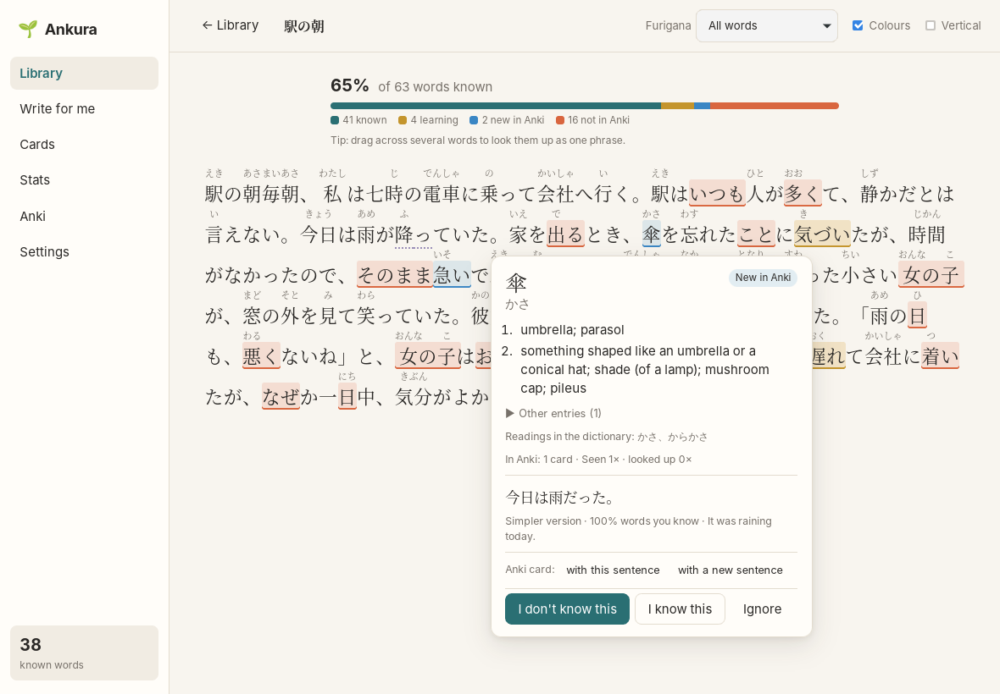

# Ankura

**Read real Japanese with your Anki knowledge switched on.**

Ankura is a desktop reading app for Japanese learners who use Anki. Paste any text and every word
is coloured by what your Anki cards say you know. A click shows a word's reading and meaning.
When a text is too hard, Ankura's AI writes one for you around the words you're learning, using
words you already know. Words you meet while reading become Anki cards in the style of your own
notes.

## What it does

- **A daily session in one place.** Today picks six words (fading Anki cards first, then words
  that keep slipping), writes the next episode of your serial story around them, and walks you
  through reading, listening, quick questions and cards. → [Today](docs/guide/today.md)
- **Make a hard text readable.** For a pasted text under 95% known words, Ankura plans and writes
  simpler retellings at about 95%, which together use every new word of the original.
  → [Simpler versions](docs/guide/reading.md#too-hard-simpler-versions)
- **Read with your Anki knowledge.** Words you know stay plain. Words you're learning, new in
  Anki, or not in Anki at all are coloured, so you see at a glance how hard a text is. Furigana
  appear only on words you don't know yet, and a wrong reading is fixed with two clicks.
  → [Reading](docs/guide/reading.md)
- **Listen while you read.** The reader reads texts aloud sentence by sentence, with the
  computer's Japanese voice or the free VOICEVOX voices. → [Listening](docs/guide/reading.md#listening)
- **Works with any Anki collection.** Point Ankura at the field that holds the word, even the bold
  word in a sentence card. It reads your cards' intervals (or FSRS memory) and knows which words
  are solid and which are fading. Ankura only adds
  cards; the one exception, a kanji mnemonic, changes only when you confirm it. → [Connecting Anki](docs/guide/anki.md)
- **Texts written for you.** Pick a few words to practise. Ankura asks the AI for a short story
  that uses them, about topics you like, checks that at least 95% of its words are ones you know,
  and asks for a rewrite if not. → [Write for me](docs/guide/write-for-me.md)
- **Help with a hard sentence.** "Simplify this sentence" rewrites it with words you know; the
  translation is there when you want it. Select several words to look up a whole phrase
  (気になります → 気になる). → [Reading](docs/guide/reading.md#help-with-a-sentence)
- **Anki cards from what you read.** One click puts a word on your card list, with the sentence you
  read it in or a new sentence where only that word is new. The AI fills the card like your own
  notes, picking the meaning the word has in that sentence. You check each card, then add it to
  Anki. → [Cards](docs/guide/cards.md)
- **Kanji with your RTK cards.** Click a kanji to see your kanji card (keyword, story) and your
  words that use it. When a story won't stick, the AI writes a new one from the kanji's primitives;
  you confirm before it goes into Anki, and can undo it. Make primitive names consistent across
  your whole set in one go. → [Kanji](docs/guide/kanji.md)
- **Find your level.** A 15-20 minute level check in the style of the JLPT (words, kanji
  readings, grammar, reading) estimates your level, how sure it is, and the CEFR equivalent.
  → [Level check](docs/guide/level-check.md)
- **Practise for the JLPT.** A mock exam for one level (N5-N1, full or half length): the JLPT's
  question types, order and times, listening optional, a pass estimate, every answer explained,
  cards for missed words and a retry round. Questions are kept in a bank and reused, so later
  tests need fewer AI requests. → [Practice test](docs/guide/practice-test.md)
- **See your progress.** Characters read per day, reading streaks, and "stealth leeches": words
  Anki says you know, but you keep looking up. → [Stats](docs/guide/stats.md)

## Getting started

1. **Install Ankura.** There are no signed releases yet. Download the installer for your system
   from the latest successful [Build run](https://github.com/drkthng/ankura/actions/workflows/build.yml)
   (Artifacts section, GitHub login needed). Windows SmartScreen will warn because the installer
   isn't signed; choose "More info" → "Run anyway".
2. **Install AnkiConnect** in Anki ([add-on 2055492159](https://ankiweb.net/shared/info/2055492159))
   and keep Anki open while Ankura talks to it.
3. **Set up dictionaries.** In Ankura's **Settings**, download SudachiDict (about 77 MB; Ankura uses
   it to split Japanese into words) and JMdict (meanings). Or import any Yomitan dictionary you
   already have.
4. **Connect Anki.** On the **Anki** screen, tell Ankura which field holds the word in each note
   type ("Suggest fields" usually gets it right), check the preview, save, and press **Sync now**.
5. **Read.** In **Library**, paste a text and start reading.
6. Optional: **set up the AI** for texts, simpler sentences and cards. → [AI setup](docs/guide/ai.md)
7. **Read [How to learn with Ankura](docs/guide/learning.md)** (also under **How to learn** in the
   app): a daily plan, step-by-step sessions, the Anki backlog after a break, and when to test.
   The evidence is in [Learning research](docs/research/learning-evidence.md); ideas for what
   comes next in [Feature ideas](docs/research/feature-ideas.md).

## Your data

Everything Ankura learns about you (texts, look-ups, marks, stats, card drafts) stays in a local
database. **Settings** shows its folder. API keys are kept in your system's keychain. When you use
an AI feature, the request goes to the AI provider you chose. It contains the words or sentence
involved and a list of up to 400 of your known words. [AI setup](docs/guide/ai.md#what-is-sent)
has the details.

## Status

Ankura is young and used daily by its first user. Japanese on desktop (Windows, macOS, Linux)
comes first. Next on the [roadmap](docs/ROADMAP.md): JLPT practice tests per level; later listening, Italian
and Spanish. Android, sync between devices,
Italian and Spanish come later. Design decisions are recorded in [`docs/adr`](docs/adr).

## Building from source

See [docs/DEVELOPING.md](docs/DEVELOPING.md).

## Licence

MIT. Dictionaries are downloaded separately and have their own licences: SudachiDict (Apache-2.0),
JMdict (EDRDG, CC BY-SA 4.0). The level check uses Jonathan Waller's JLPT lists
([tanos.co.uk](https://www.tanos.co.uk/jlpt/), CC BY).
