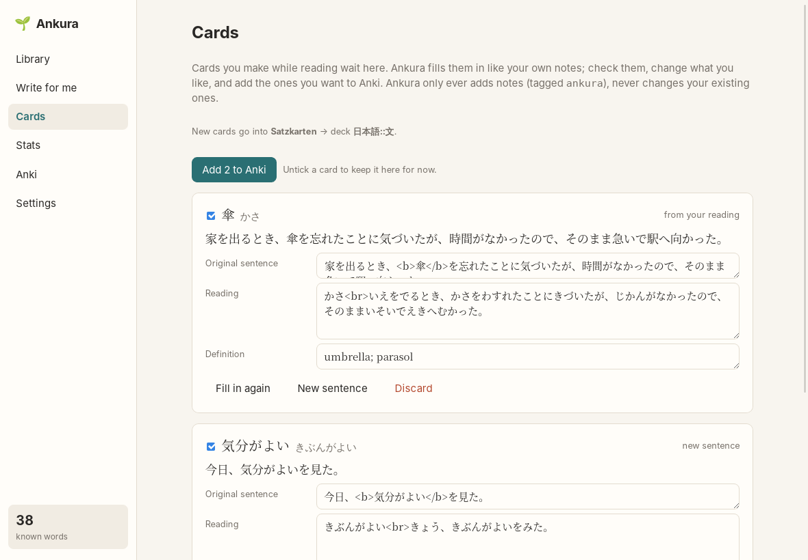

# Cards

[← README](../../README.md)

Ankura turns words you meet while reading into Anki cards that look like the cards you already
have.

## Setting up

In **Settings → Anki cards**, choose the **note type** and **deck** new cards go into, once. Ankura
fills cards in by looking at your newest notes of that note type, so pick the one whose cards you
want more of.

## Where cards come from

- **The word pop-up** in the reader → *Anki card*:
  - **with this sentence:** the sentence you're reading;
  - **with a new sentence:** the AI writes one in which only this word is new to you. Ankura checks
    every other word against what you know and asks again if needed.
- **A selected phrase** works the same way ([Phrases](reading.md#phrases)).
- **Texts written for you:** *Make Anki cards* under the example sentences makes one card per
  practice word, using its sentence from the text.
- **Words you looked up:** the Cards screen lists words you clicked "I don't know this" on; *+*
  makes a card with a new sentence.
- **Write for me → Make cards:** one card per picked word, each with a new sentence.
- **Stats:** *+ card* on stealth leeches and often looked-up words.

## The card list

Every card waits on the **Cards** screen first. Ankura fills in its fields with the AI:

- it shows the AI your three newest notes of the chosen type, so the new card copies their
  layout: which field holds what, bold around the word, line breaks, the language of the
  definition;
- it gives the AI the facts: the word, its reading, the sentence, the sentence's reading, and
  every dictionary meaning. The AI picks the meaning the word has *in this sentence*. The first
  meaning in the dictionary is often not the right one;
- audio and image fields stay empty.

You can edit every field. **New sentence** replaces the sentence and fills the card again;
**Fill in again** just asks the AI again. Untick cards you want to keep for later, and press
**Add to Anki**.

**Change a card by asking the AI.** Under each card, type what you want different and press
Enter or **Change**: "an example with ほど…ない", "use the kanji spelling", "a sentence about
cooking", "shorter definition". The AI changes the sentence and every field that depends on it
(the marked word, the reading, the meaning), in your card's format, and leaves the rest alone. The
buttons below the box are common requests in one click. **Undo** puts the card back as it was
before the last change.

Turn on **Add cards to Anki straight away** in Settings to skip the list.

## Safe for your collection

Ankura only adds notes and tags each one `ankura`, so you can find them in Anki's browser
(`tag:ankura`). If Anki already has a note with the same first field, Ankura tells you instead of
adding a duplicate. It never changes existing notes.

Without the AI ([AI setup](ai.md)) cards still work, but you fill in the fields yourself (**Fill
in by hand**).
