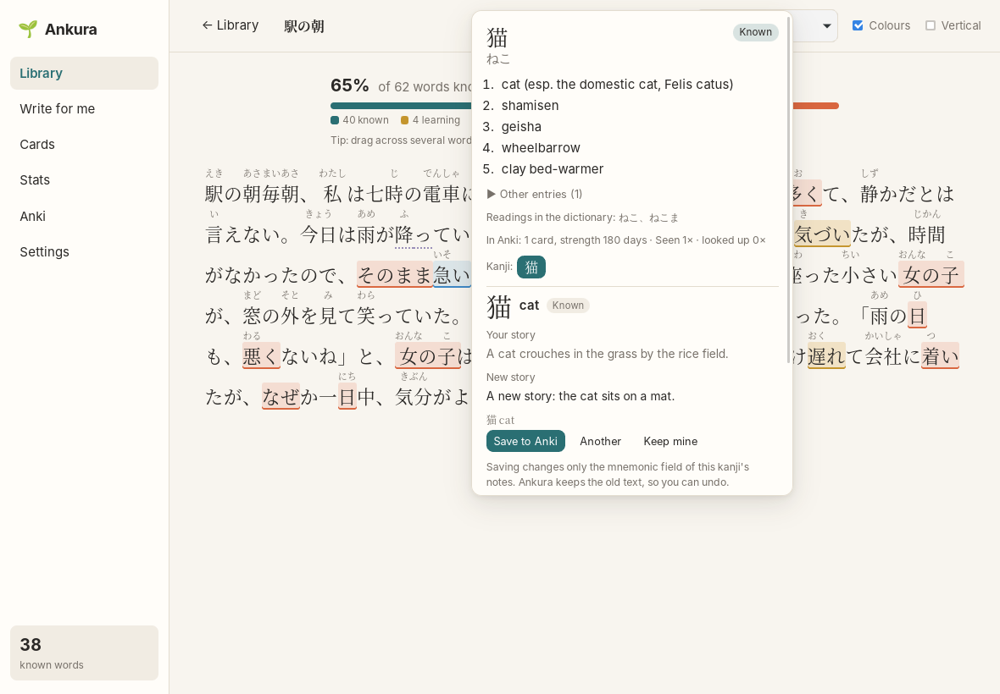
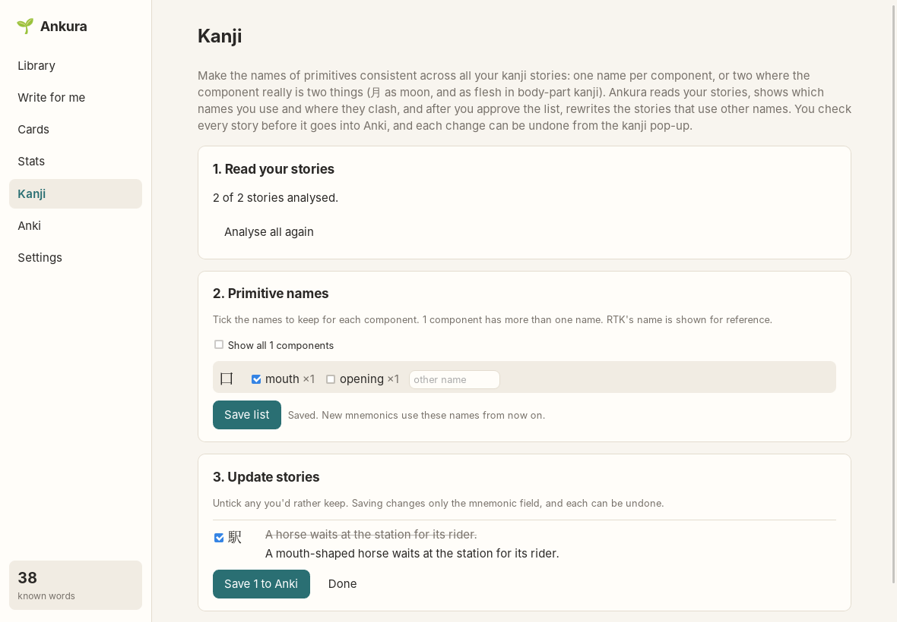

# Kanji

[← README](../../README.md)

If you learn kanji with their own Anki cards, the way Remembering the Kanji (RTK) teaches them (a
keyword and a mnemonic story built from the kanji's parts), Ankura can show those cards while you
read and help when a story doesn't stick.

## Setting up

On the **Anki** screen, under **Kanji notes**, choose your kanji note type from *Add a kanji note
type…*. Ankura suggests which field holds the kanji, the keyword and the mnemonic; check them and
**Save**. Map both note types if you have two (say, kanji → keyword and keyword → kanji). A kanji
in both counts once, and its strongest card decides how well you know it. Then **Sync now**.

## In the reader

The word pop-up lists the kanji of the word. Click one to see:

- its **keyword** and how well Anki says you know it;
- its **story**, hidden until you click *Show story* (as on your cards, so you can test yourself
  first);
- **your words** that use this kanji, from your Anki collection.

## A new mnemonic

When a story doesn't work for you, press **New mnemonic**. The AI writes a new RTK-style story from
the kanji's primitives. It uses the primitive names from your other stories, RTK's names where you
have none, and the meaning that fits this kanji where a component has two (月 as moon or as
flesh). The story keeps your stories' language and formatting. You see your story and the new one
side by side, with the primitives it used:

- **Save to Anki** writes it into the mnemonic field of this kanji's notes, in all mapped note
  types;
- **Another** asks for a different one; **Keep mine** closes it.

## What Ankura may change

This is the one place Ankura changes notes you already have, so it's deliberately narrow:

- only the field you mapped as the **mnemonic**, only on your mapped **kanji note types**;
- only when you press **Save to Anki**;
- before writing, Ankura keeps the old story in its own database, and tags the note
  `ankura-edited` (find them in Anki with `tag:ankura-edited`);
- **Undo Ankura's change** puts the old story back. If you've edited the story in Anki since,
  Ankura leaves your version alone.

## Consistent primitive names

Over years of stories, the same component tends to get different names ("mouth", "opening",
"entrance"), and some components really are two things (月 as moon, and as flesh in body-part
kanji). The **Kanji** screen cleans this up across your whole set, in three steps:

1. **Read your stories.** The AI reads all your stories, about 40 per request, and notes which
   primitives each one uses and the names it gives them. You see the progress and can stop; it
   continues where it left off. Stories you change later are read again.
2. **Primitive names.** For each component: the names you use, how often, and RTK's name for
   reference. Components with several names come first. Tick the names to keep (usually one; two
   where the component really is two things), or type your own, and **Save list**. New mnemonics
   use this list from then on.
3. **Update stories.** Ankura lists the stories that use a name not on your list, and the AI
   writes new versions that change only those names. You see old and new side by side, untick any
   you'd rather keep, and save the rest. The same rules as for a single new mnemonic apply:
   mnemonic field only, old text kept, undo from the kanji pop-up.

Decision record: [ADR 0013](../adr/0013-kanji-and-rtk-mnemonics.md).
