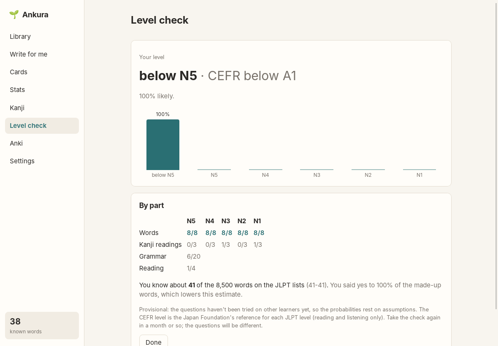

# Level check

[← README](../../README.md)

A 15-20 minute test that estimates your Japanese level on the JLPT scale (N5 to N1), says how sure
it is, and what that means in CEFR terms. It is in the style of the JLPT, but every question is
Ankura's own: official JLPT questions are copyrighted.

## The four parts

1. **Words** (about 1 minute): is this a word you know? Yes or no, 40 real words from the five
   levels and 16 made-up ones. Saying yes to made-up words lowers your score, so only say yes if
   you know the word. Words your Anki already knows aren't asked; they count as known anyway.
2. **Kanji readings:** 15 words, pick the reading. The wrong options are near misses (voicing, long
   vowels, small っ).
3. **Grammar:** fill the blank, 8 questions at your starting level, then 12 more at the same
   level, one easier or one harder, depending on how the first 8 went.
4. **Reading:** two short passages with questions, at the level the test has found so far.

Keyboard: **K** / **D** for know / don't know, **1-4** for the options.

Grammar and reading are written by the AI while you work (the first grammar part while you do the
words). A second AI call answers every question without the key; questions it gets wrong or finds
ambiguous are dropped, and so are reading questions it can answer without the passage. This
needs the AI ([AI setup](ai.md)); it is sent only the level, never anything about you.

## Starting level

Ankura shows how many of each level's words your Anki knows and suggests a starting level from
that. Pick another if you like; it only decides where the grammar starts.

## The result

- **Your level** and how likely it is, with the probability of each level. When the top level
  isn't clearly ahead, the ones next to it are possible too.
- **By part:** right answers per part and level. For words, the green/grey marking is corrected
  for yes-answers to made-up words.
- **Your vocabulary:** about how many of the 8,500 words on the JLPT lists you know: Anki's,
  plus the share of the rest you knew in the test, with a range.
- **CEFR:** the Japan Foundation's reference for each JLPT level (N5 A1, N4 A2, N3 A2-B1, N2
  B1-B2, N1 B2-C1). It covers reading and listening only.

The result is **provisional**: the questions haven't been tried on other learners, so the
probabilities rest on assumptions about how often learners at each level get each kind of
question right. Ankura keeps every test and answer, so later versions can do better. Take it
again in a month or so; the questions are new each time.

## Where the levels come from

Word and kanji levels: JLPT lists by Jonathan Waller ([tanos.co.uk](https://www.tanos.co.uk/jlpt/)),
CC BY. There have been no official lists since 2010; these are the standard community lists, a
good guide but not the official test. Background: [research notes](../research/proficiency-tests.md),
[ADR 0014](../adr/0014-proficiency-level-check.md). Coming later: JLPT practice tests per level,
Italian and Spanish, listening.
