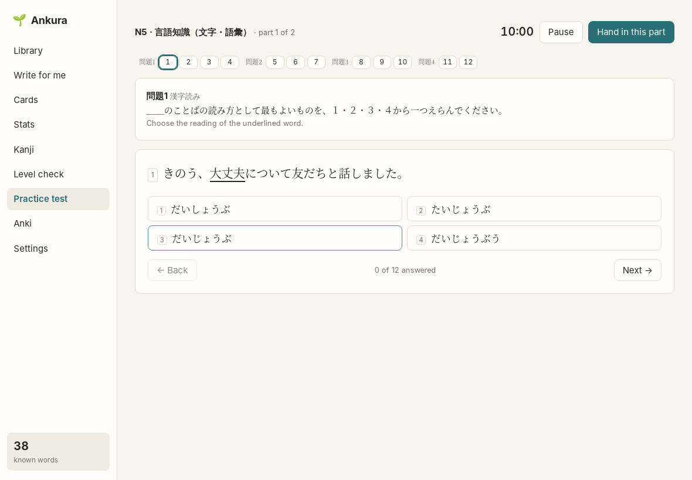
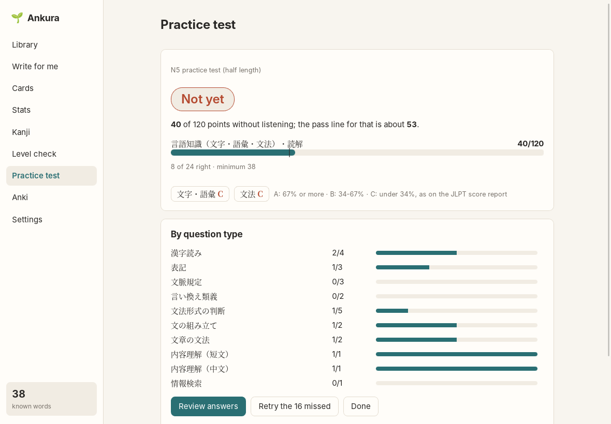

# Practice test

[← README](../../README.md)

A mock JLPT for one level, N5 to N1: the exam's question types (問題) in the exam's order, with
its time limits. Listening isn't included yet. Every question is Ankura's own, written by the AI
around words from the JLPT lists and checked before you see it; none come from the JLPT or from
prep books.

## Starting a test

Pick:

- **Level.** Ankura suggests the level above your last [level check](level-check.md) result
  (the one you're working towards), or, without one, a level from your Anki knowledge.
- **Length.** *Full* has about as many questions as the real exam (N5 43, N4 57, N3 74, N2 73,
  N1 70, without listening) and its time (N5 60 minutes … N1 110). *Half* keeps every question
  type with half the questions and half the time.
- **Questions.** Every question Ankura writes is kept in a question bank, also the spare ones a
  test didn't need. *Bank first* (the default) takes as many as it can from there and has the AI
  write the rest; *Half new* takes at most half; *All new* has everything written fresh. Only
  questions you haven't had in a test are reused, unless you tick *Include questions from
  earlier tests*. Below the choices Ankura shows how many questions the bank has for the level
  and how many the new test takes from it; when it can take all of them, the test is ready at
  once, with no AI requests. Reported questions never come back.
- **Timer.** On: each part counts down from the official time. When time is up, Ankura tells you;
  you can hand in or keep going, and the result marks the part as overtime. Off: the clock just
  counts up.

Then **Prepare the test**. Ankura writes the questions the bank can't supply before you start: for
a full test written from scratch a few minutes and about 15-25 AI requests (half of that for a
half test); less when the bank helps. You can stop and continue
later; questions already written are kept. This needs the AI ([AI setup](ai.md)); the AI is sent
the level and the words to build questions on, never anything about you.

## Taking it

- The parts follow the JLPT: N5-N3 have 文字・語彙 first and then 文法・読解; N2 and N1 have one
  part. **Hand in this part** moves on; you can't go back to a handed-in part.
- The row of numbers at the top shows every question of the part, grouped by 問題; answered ones
  are greyed. Click a number to jump; change answers as often as you like.
- Each question type starts with the exam's instruction in Japanese and a one-line English hint.
- Reading texts stay on the left while you answer their questions on the right. In 文章の文法 the
  blank you're answering is highlighted in the text.
- Keyboard: **1-4** to answer, **←** / **→** for the previous / next question.
- **Pause** keeps your answers and time; the test waits under "Your tests".

## The result

- **Verdict:** *Likely pass*, *Borderline* or *Not yet*, from your score against the pass line.
- **Score** per section as on the JLPT score report: N3-N1 言語知識 (vocabulary and grammar) and
  読解, 0-60 each; N5 and N4 言語知識・読解 0-120. The mark on each bar is the sectional minimum:
  below it, the real exam fails you whatever your total.
- **Pass line:** the official pass mark scaled to the sections tested (for example N3: 95 of 180
  with listening, so about 63 of 120 here). *Borderline* means within 6% of the maximum around it.
- **A / B / C** for 文字・語彙 and 文法, with the score report's cut-offs (67% and 34%).
- **By question type:** right answers per 問題, to see where the points went.

It's an estimate, not a JLPT score. The real exam weights questions by difficulty (item response
theory), which Ankura can't reproduce, and it includes listening. AI-written questions may be
easier or harder than the real ones.

## Review, cards and retry

- **Review answers** shows every question (or only the missed ones) with your answer, the right
  one, and an explanation.
- **Report a bad question** if a question is wrong or has two right answers. It's left out of
  the score straight away, never reused in a later test, and stored so later versions can learn
  from it.
- **Anki card for …** drafts a card for the word a missed vocabulary question was about, the same
  way as from the reader ([Cards](cards.md)); **Anki cards for all missed words** does it for all
  of them.
- **Retry the missed** starts a short untimed round with only the questions you got wrong. No AI
  requests; it's listed under "Your tests" like the others.

## How questions are made

Details in [ADR 0015](../adr/0015-jlpt-practice-tests.md). In short:

- Ankura picks the words to test from the JLPT lists at the test's level (Jonathan Waller,
  tanos.co.uk, CC BY), so the AI writes around its choices instead of recalling prep books.
- 漢字読み: the AI only writes the sentence; the wrong readings are made by rule (voicing, long
  vowels, small っ), and any the dictionary knows as a real reading of the word are dropped.
- 文の組み立て: the AI writes the sentence and the four pieces in order; Ankura shuffles them and
  asks for the third.
- A second AI call answers every question without the key; questions it gets wrong or finds
  ambiguous are dropped, and so are reading questions it can answer without the text.
- With the Japanese dictionary set up, sentences using JLPT-list words two or more levels above
  the test are dropped.
