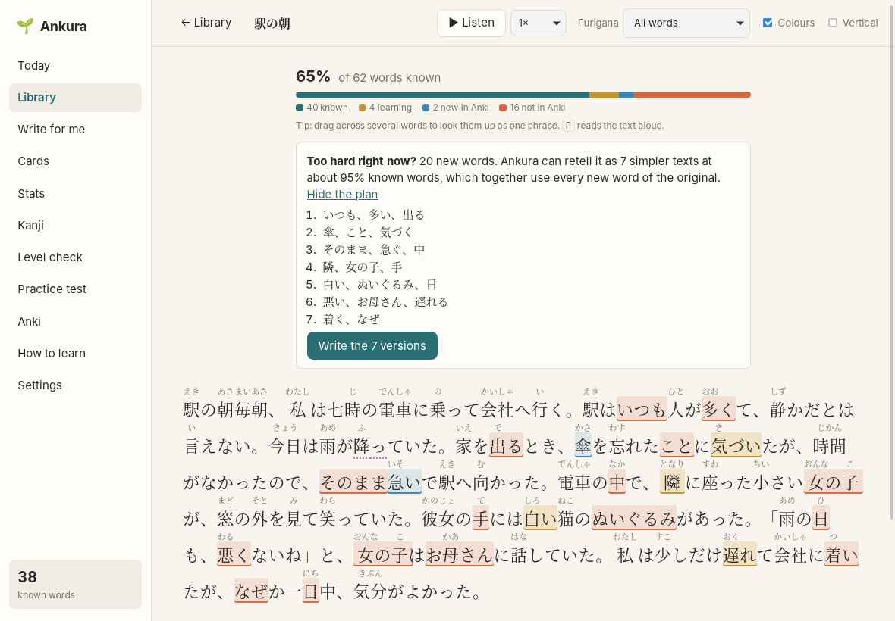
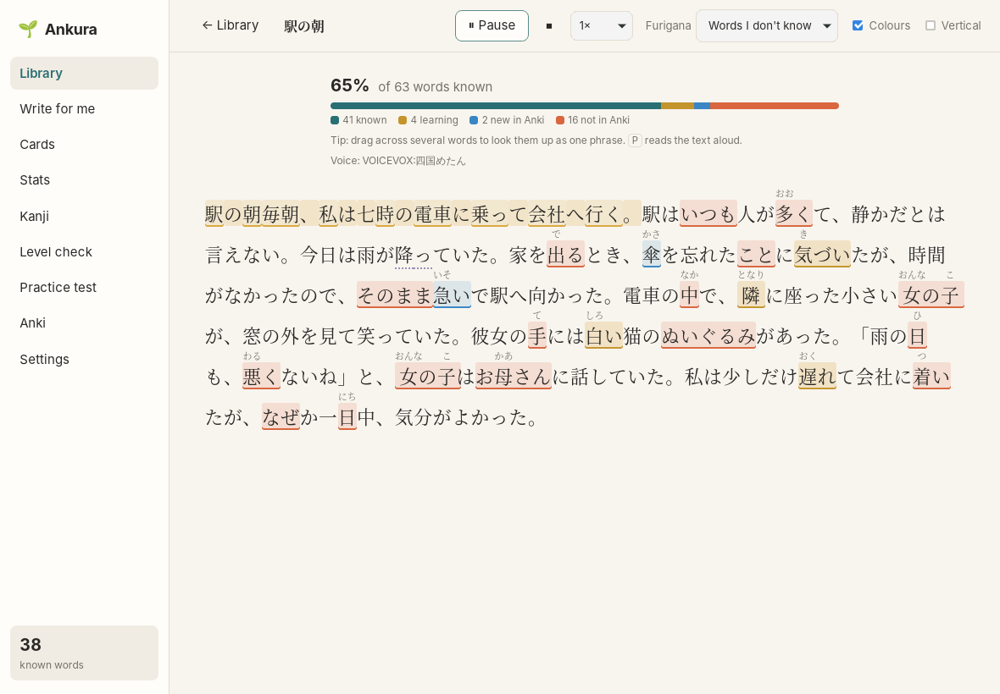

# Reading

[← README](../../README.md)

## Adding a text

In **Library**, paste any Japanese text (an article, a chapter, lyrics), give it a title if you
like, and press **Start reading**. Texts that Ankura writes for you ([Write for me](write-for-me.md))
land in the Library too.

## What the colours mean

The bar at the top shows the share of words you know, split by Anki state:

| In the text | Meaning |
|---|---|
| plain | You know it: Anki says it's known (interval or FSRS stability of at least 21 days, adjustable in Settings), you marked it known, or it's a very common word |
| dotted underline | Known, but fading: Anki estimates you're likely to forget it soon |
| yellow | Learning in Anki |
| blue | New in Anki (a card you haven't studied yet) |
| red | Not in Anki at all |

Particles, names and numbers aren't counted. A compound like 一時的 counts as known when you know
all its parts. Turn colours off with the **Colours** switch.

**Furigana** can be shown on words you don't know (the default), on all words, or not at all.
**Vertical** switches to vertical writing.

## The word pop-up

Click a word to see its reading, meanings from your dictionaries, what Anki knows about it, and
how often you've seen and looked it up.

**English | 日本語** switches the meaning between English and Japanese; Ankura remembers your
choice. 日本語 shows a short explanation in simple Japanese of what the word means *in this
sentence*, written by the AI with words you know where possible (furigana on the ones you don't),
and entries from any Japanese-Japanese dictionary you imported. The explanation is kept, so
switching back later costs no AI request.

Then:

- **I don't know this:** remembers that you struggled with it. Such words show up as suggestions
  in [Write for me](write-for-me.md) and on the [Cards](cards.md) screen.
- **I know this:** marks it known everywhere, whatever Anki says. **Ignore** is for names and
  foreign words you never want highlighted. **Clear mark** undoes either.
- **Anki card:** puts the word on your card list, with this sentence or a new one. See
  [Cards](cards.md).

## Wrong furigana?

Ankura works out readings with a dictionary of how words are usually read, and corrects the
sound changes of numbers with counters (三匹 さんびき, 一本 いっぽん, 六分 ろっぷん, 二日 ふつか). Some words
are read differently depending on context (人気のない ひとけ, 十分 じっぷん when it means ten minutes,
この方 かた or ほう), and Ankura can get those wrong.

Click the word and the **✎** next to its reading. Pick one of the readings the dictionary lists,
or type one, and choose whether it applies **in this text** or **everywhere**. For a word in its
dictionary form the correction also changes which word Ankura takes it for (人気 read ひとけ is
"sign of life", not "popularity"), so the meaning and your Anki state follow. **Reset** goes back
to Ankura's reading.

## Phrases

Drag across several words to look them up as one phrase. Ankura reduces it to its dictionary form
(気になります → 気になる) and shows the dictionary entry for the whole phrase. Phrases work like
words: mark them, or make a card. Once a phrase is in Anki or marked known, the reader shows it
as one word wherever it appears, also conjugated (気になって).

## Help with a sentence

**Translate this sentence** in the pop-up gives an English translation that fits the text around
it (who does what, what refers to what), plus a line on what the word you clicked means in this
sentence, the way it would go on a card. Translations are kept: asking again is instant.

**Simplify this sentence** asks the AI to rewrite the sentence with words you know. Ankura checks
the result and asks once more if it still has too many unknown words. You see the simpler version
with furigana on the words you don't know yet, and the English translation only when you click
**Show translation**. Both need the AI ([AI setup](ai.md)).

## Too hard? Simpler versions

Texts below 95% known words are hard to learn from. For such a text, the reader offers to retell
it as simpler texts:

- Ankura lists the text's new words in order and splits them into groups, about 5% of a version's
  words each (2-8 words). **Show the plan** shows which words go into which version. No AI is
  used for the plan.
- **Write the versions** has the AI retell the text, or one part of a long text, once per group:
  same content, events and order, in simpler Japanese, using that group's words in the meaning
  they have in the original. Each version is checked like Write for me's texts (about 95% known
  words) and saved in your library.
- Taken together, the versions use every new word of the original. If the AI leaves a word out,
  the reader says which and offers **Write a version for them**.
- Each version links back to the original. Read the versions, then the original: by then most of
  its new words have come up once already.

A short text with many new words gets many versions, each a retelling of the same story with
other words. That is fine for learning (the same content read again, with new words each time),
but you can also stop after a few and simply read the original.

## Listening

**▶ Listen** in the toolbar (or **P**) reads the text aloud, sentence by sentence; the sentence
being read is highlighted. **P** pauses and resumes, ⏹ stops, and the menu next to it sets the
speed. In the word pop-up, 🔊 says the word, and **Listen from here** reads from its sentence.

The voice is your computer's Japanese voice, or VOICEVOX when it's running:

- **Your computer's voices** work without anything else. If Ankura finds none: on Windows,
  Settings → Time & language → Speech → Add voices → Japanese; on a Mac, System Settings →
  Accessibility → Spoken Content → System voice → Manage voices.
- **VOICEVOX** is a free program with much more natural Japanese voices
  (voicevox.hiroshiba.jp). Install it and start it; Ankura finds it by itself. Pick a voice in
  Settings → Listening. Ankura keeps every sentence it has had spoken, so a text you hear again
  plays at once.

Where a voice is likely to guess wrong, Ankura tells it the reading the furigana shows: for
names, for less common words (beyond the JLPT N3 lists), and for every word whose reading you
corrected ([Wrong furigana?](#wrong-furigana)). So a word the voice mispronounces is fixed by
correcting its reading. Common words keep their kanji, which helps the voice see where words
start (と山崎は言った, not はいった).
To let the voice work out readings on its own instead, untick *Read words as the furigana shows
them* in Settings → Listening.

## What Ankura counts

A paragraph counts as read after about three seconds on screen. Ankura then records that you saw
its words and how many characters you read. Those numbers feed the [Stats](stats.md) and the
word suggestions. They stay on your computer.
