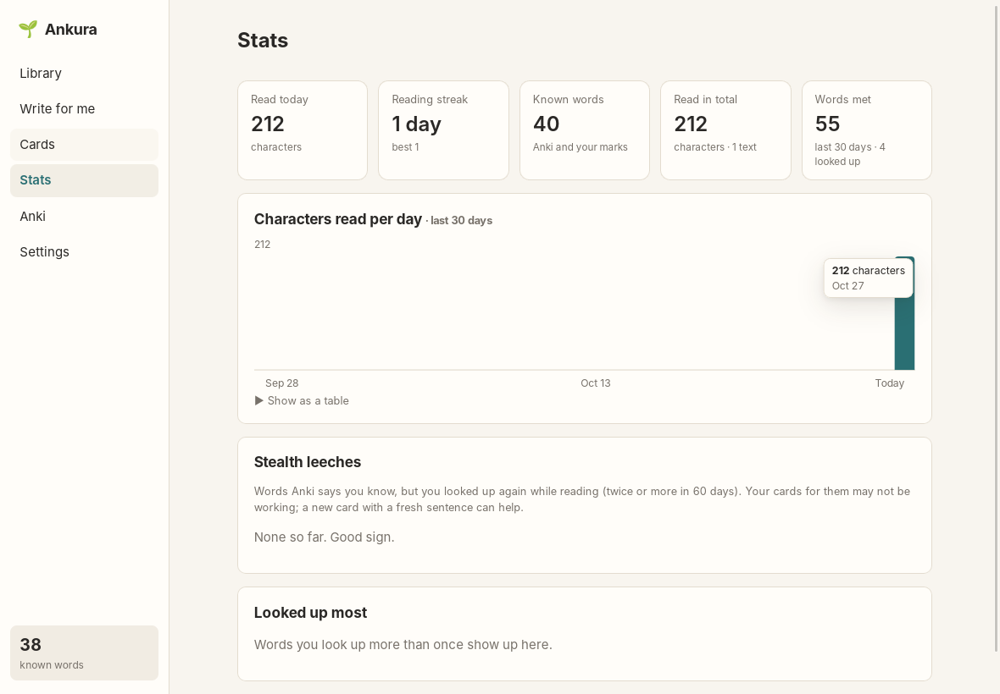

# Stats

[← README](../../README.md)

The **Stats** screen shows:

- **Read today** and **read in total:** characters in paragraphs you actually read. A paragraph
  counts after about three seconds on screen.
- **Reading streak:** days in a row with some reading. Today doesn't break it until it's over.
- **Known words:** known or fading in Anki, plus words you marked known.
- **Words met** in the last 30 days, and how many of them you looked up.
- **Characters read per day** for the last 30 days. Hover a bar for the number, or open the table
  view.

## Stealth leeches

A leech, in Anki terms, is a card you keep failing. A *stealth* leech is one you keep passing in
Anki but still don't recognise in real text. Ankura spots these: words Anki says are known or
fading that you looked up **twice or more in the last 60 days** while reading. Your existing card
for them evidently isn't working. **+ card** makes a new card with a fresh sentence
([Cards](cards.md)).

**Looked up most** lists your biggest friction words, whatever Anki says about them.

All of this is computed from what Ankura records on your computer; nothing is sent anywhere.
