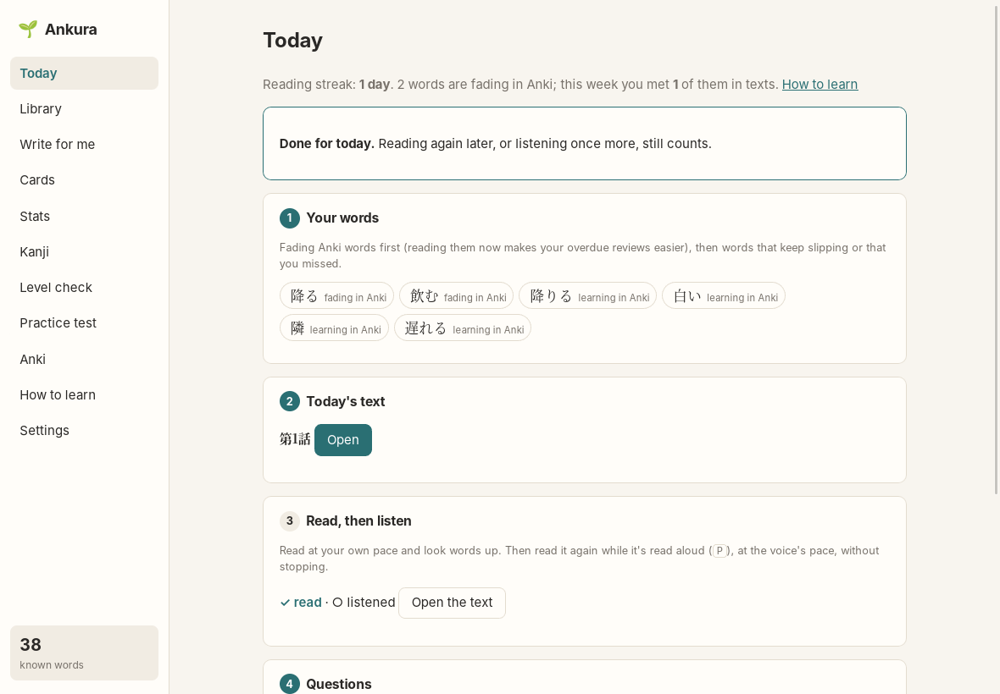

# Today

[← README](../../README.md)

**Today** is a daily session in five steps, on one screen. It's Ankura's start screen.

## 1. Your words

Ankura picks six words to practise:

- **About half are fading in Anki:** cards that are overdue. Reading them in a text just before
  your Anki reviews makes those reviews easier (Ankura never changes your Anki schedule).
- Then a word that **keeps slipping** (Anki says you know it, but you keep looking it up), a word
  you **missed in questions**, one you **looked up**, and words you're **learning** in Anki.
- Words used in a text since yesterday wait a day.

Remove a word with ×, add your own, or press **Other suggestions**. The line at the top shows how
many words are fading in Anki and how many of them you met in texts this week.

## 2. Today's text

- **Continue a story:** the next episode of a serial story. It keeps the characters and setting,
  picks up from last time, and brings back up to three words from earlier episodes, so words
  return over several days.
- **Start a new story:** give it a title and a topic (or leave the topic empty to use your
  interests), a length and a style. The AI invents the characters and setting with episode 1.
- **A single text:** a one-off text, as on [Write for me](write-for-me.md).

Writing takes about a minute; the text then opens in the reader.

## 3. Read, then listen

The reader shows today's steps at the top:

1. Read at your own pace; look words up and make cards. Press **Done reading**.
2. Press **Listen** (or **P**) and follow the highlighted sentence at the voice's pace, without
   stopping. The step counts as done when the read-aloud reaches the end.

## 4. Questions

Three or four quick questions: two about what happens in the text, and fill-the-gap questions on
today's words, using sentences from the text. Each answer shows why straight away. Words you miss
come back in the next days' words.

The same questions are at the end of every text in the reader (**Check yourself**). A text's
questions are written once and kept, so asking again costs no AI request.

## 5. Cards

**Open Cards** to check the cards you made while reading, change them by asking the AI, and add
them to Anki ([Cards](cards.md)).

Steps can be done in any order, or skipped. When reading and questions are done, Today says so.
Reading again later still counts for your streak and stats.
