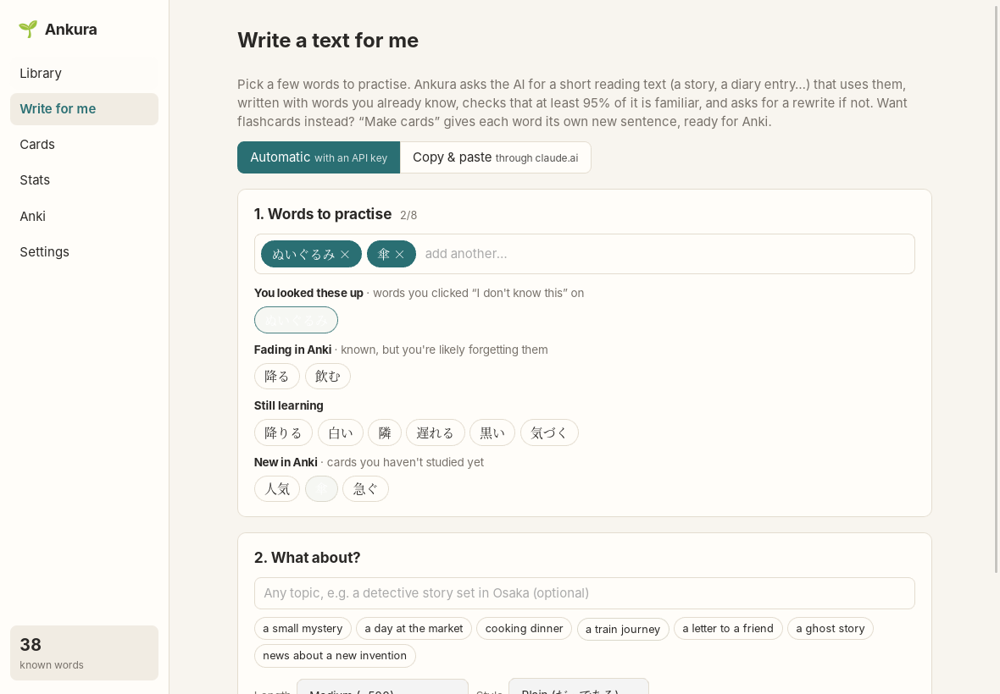

# Write for me

[← README](../../README.md)

Reading texts that are mostly words you know, with a few new ones, is one of the best ways to
learn those new ones. Few real texts fit your level that well, so Ankura writes them for you.

## Writing a text

1. **Pick up to eight words to practise.** Suggestions come from your reading and Anki: words you
   clicked "I don't know this" on, words fading in Anki, words you're learning, new cards. Or type
   any word.
2. **Choose a topic** (optional). Leave it empty and the AI picks one, or click one of the ideas.
3. **Choose the length** (about 300, 500 or 900 characters) and the **style**: plain (だ・である)
   or polite (です・ます).
4. Press **Write it**.

The AI writes a short story, scene, diary entry or article. It is asked to use your words in
contexts that make their meaning guessable, and otherwise only words from your known-word list.
Ankura then checks the text itself:

- it splits the text into words, as the reader does;
- at least **95%** of the words have to be known (your practice words count as known);
- every practice word has to appear.

If the text falls short, Ankura tells the AI which words you don't know and asks for a rewrite, up
to three tries, and keeps the best one. The text opens in the reader, with example sentences for
your words underneath and a button to make [Anki cards](cards.md) for them.

## Your interests

Under the topic, **Tell Ankura what you like** (or *Edit your interests*) opens your interest
profile:

- **Topics you like**, each read about less, normally or more often. They replace the standard
  topic ideas. When you leave the topic empty, Ankura picks one of them for the text, the "more"
  ones more often, and shows which.
- **Suggest from my reading:** the AI looks at the texts you pasted and the topics you asked for,
  and suggests topics; click one to add it.
- **Never write about:** topics the AI should avoid in every text.

## Just sentences: Make cards

Want one sentence per word instead of a text? **Make cards** writes a new sentence for each
picked word, in which only that word is new to you, and puts them on your [card list](cards.md).

## Copy & paste through claude.ai

Without an API key, switch the mode at the top to **Copy & paste**. Ankura gives you the request
to paste into a chat on claude.ai. You paste Claude's reply back, and Ankura runs the same check.
If the text isn't familiar enough, Ankura gives you a short rewrite request for the same chat, or
you keep the text anyway. See [AI setup](ai.md).
